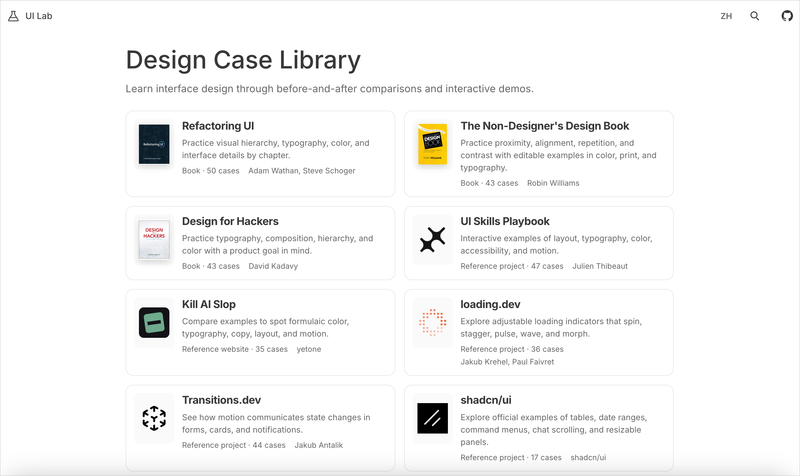

<div align="center">
  <h1><sup></sup>&nbsp; UI&nbsp;Lab</h1>
  <p><strong>A hands-on library of UI design cases.</strong></p>
  <p>401 cases · 12 sources · v1.2.0</p>
  <p>
    <a href="./README.md" lang="zh-CN">简体中文</a> · English
  </p>
  <p>
    <a href="https://ui-lab.wangruofeng007.com/en">Explore the library</a> ·
    <a href="https://ui-lab.wangruofeng007.com/sitemap.xml">XML sitemap</a>
  </p>
  <a href="https://ui-lab.wangruofeng007.com/en">
    
  </a>
</div>

## Features

- **Browse by chapter or search across sources.** Explore cases from design books, component libraries, and motion projects, or press `⌘K` or `Ctrl+K` to search the whole library.
- **Compare before and after.** Edit the poster headline, toggle layout guides, and play the transition to see how alignment and visual hierarchy affect readability. [Try the poster redesign](https://ui-lab.wangruofeng007.com/en/non-designers-design-book/easy-design)
- **Try motion in context.** Click the plus button to open the menu, then select an action or press `Esc` to close it. Watch the transition in both directions. [Try the Gooey plus menu](https://ui-lab.wangruofeng007.com/en/transitions-dev/gooey-plus-menu)
- **Apply a case to your own project.** Copy the Markdown from the Prompt tab and give your agent the case link, design guidance, and acceptance criteria to adapt to your interface.
- **Switch languages on the same page.** Use the header link to switch between Simplified Chinese and English while viewing the same source or case.

## Quick start

Open the [online case library](https://ui-lab.wangruofeng007.com/en), or run it locally with Node.js and npm.

```sh
git clone https://github.com/wangruofeng/ui-lab.git
cd ui-lab
npm start
```

Open [127.0.0.1:4322/en](http://127.0.0.1:4322/en). The local preview runs without installing npm dependencies. Once it starts, you can open the [sitemap](http://127.0.0.1:4322/en/sitemap) or the [poster redesign case](http://127.0.0.1:4322/en/non-designers-design-book/easy-design).

### Install the skill for an agent

Run the following command in the target project and select the agent to install it for. The Skills CLI requires Node.js 22.20 or later. [Installation documentation](https://github.com/vercel-labs/skills#install-a-skill)

```sh
npx skills add wangruofeng/ui-lab --skill ui-lab-ui-improvement
```

The command installs the skill in the current project by default. Add `-g` to use it across projects, or copy the entire [UI improvement skill](./skills/ui-lab-ui-improvement/) directory to your agent's skills directory.

> Use `ui-lab-ui-improvement` to find a case for improving upload failure feedback.

## More documentation

- [Case sources and asset licenses](./docs/sources.en.md)
- [Development, builds, and demo maintenance](./docs/maintenance.en.md)

Original code is available under the [MIT License](./LICENSE). See the [disclaimer](./DISCLAIMER.en.md) for third-party materials and how to submit feedback.
