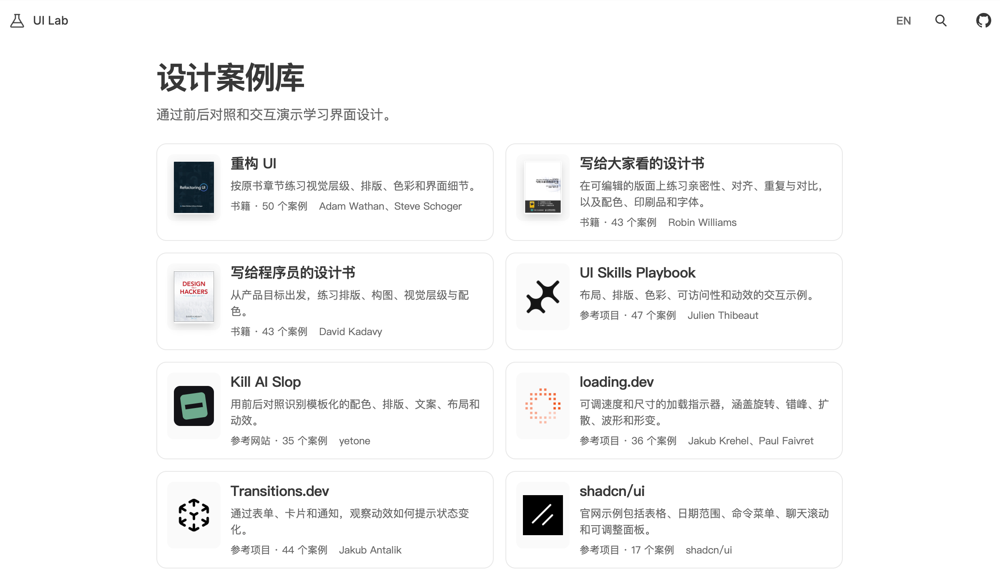

<div align="center">
  <h1><sup></sup>&nbsp; UI&nbsp;Lab</h1>
  <p><strong>一个可以动手体验的 UI 设计案例库。</strong></p>
  <p>401 个案例 · 12 个来源 · v1.2.0</p>
  <p>
    <a href="https://ui-lab.wangruofeng007.com/">在线体验</a> ·
    <a href="https://ui-lab.wangruofeng007.com/sitemap.xml">XML 索引</a>
  </p>
  <a href="https://ui-lab.wangruofeng007.com/">
    
  </a>
</div>

## 功能

- **对照改版前后**。看同样的内容怎样读得更清楚，例如海报重排。
- **动手操作演示**。试试失败后就地重试，或比较状态指示器的光晕。
- **用案例优化自己的界面**。跨来源搜索，在案例页复制带有参考链接和验收条件的 Markdown 提示词。

## 快速开始

直接打开[在线案例库](https://ui-lab.wangruofeng007.com/)，也可以使用 Node.js 和 npm 在本地运行。

```sh
git clone https://github.com/wangruofeng/ui-lab.git
cd ui-lab
npm start
```

打开 [127.0.0.1:4322](http://127.0.0.1:4322/)。日常预览无需安装 npm 依赖。启动后可以直接打开[站点地图](http://127.0.0.1:4322/sitemap)或[海报重排案例](http://127.0.0.1:4322/non-designers-design-book/easy-design)。

### 为 Agent 安装 Skill

推荐在目标项目中运行以下命令，再选择要安装到的 Agent。Skills CLI 需要 Node.js 22.20 或更高版本。[安装文档](https://github.com/vercel-labs/skills#install-a-skill)

```sh
npx skills add wangruofeng/ui-lab --skill ui-lab-ui-improvement
```

默认安装到当前项目。需要跨项目使用时加 `-g`。也可以将 [UI 优化 Skill](./skills/ui-lab-ui-improvement/) 整个目录复制到所用 Agent 的技能目录。

> 用 `ui-lab-ui-improvement` 找一个适合优化上传失败反馈的案例。

## 更多文档

- [案例来源与素材许可](./docs/sources.md)
- [开发、构建与演示维护](./docs/maintenance.md)

原创代码采用 [MIT 许可证](./LICENSE)。第三方素材的使用范围和反馈方式见 [免责声明](./DISCLAIMER.md)。
